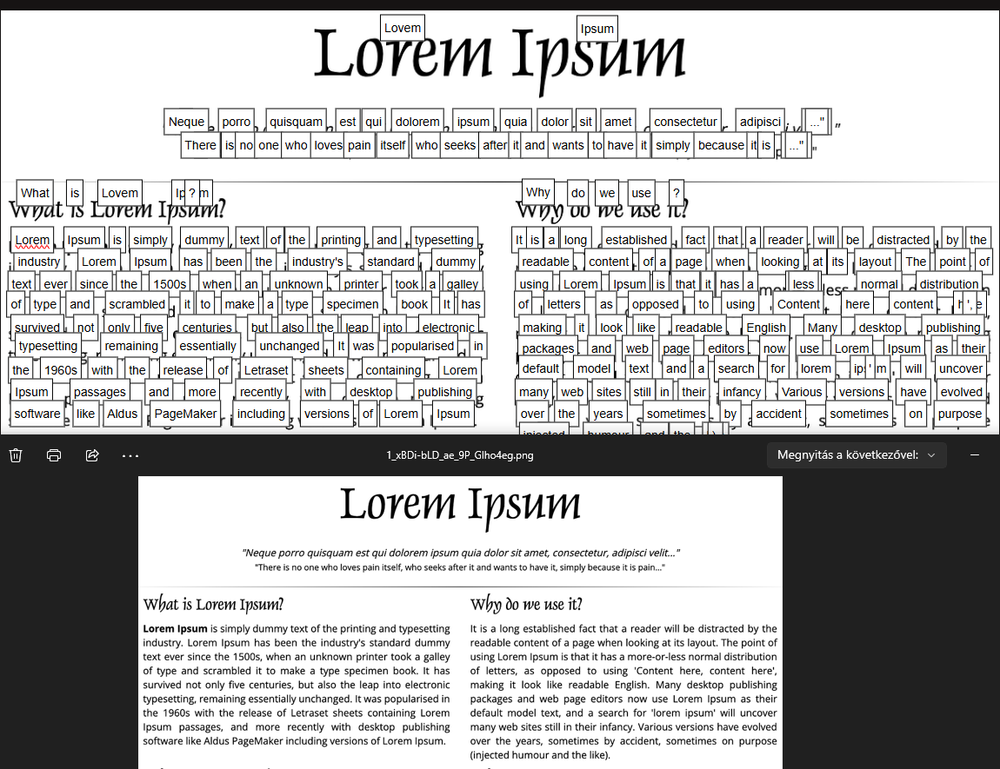
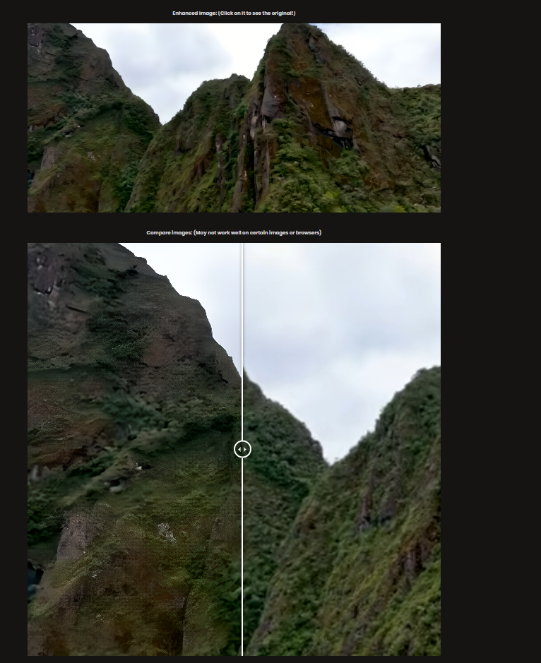
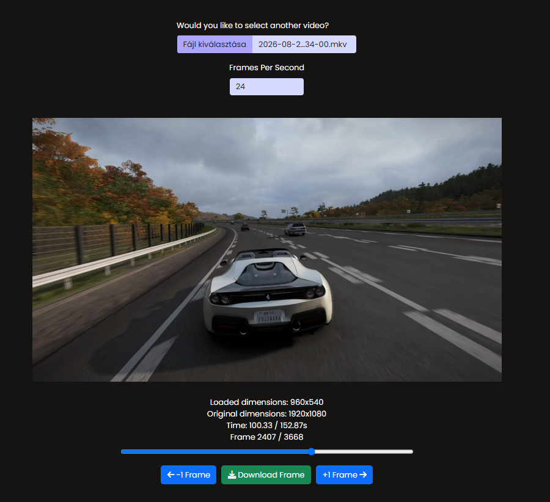

<div align="center">

# ✨ ImageGen

**A full-stack AI creative suite — image generation, enhancement, OCR, frame extraction and 3D object generation, wrapped in a complete, production-style Flask web app with its own auth, credits and community system.**


</div>

---

## 📑 Table of Contents

- [About](#-about)
- [Features](#-features)
- [Demo](#-demo)
- [Tech Stack](#-tech-stack)
- [Authentication & Security](#-authentication--security)
- [Data Model](#-data-model)
- [Real-World Usability](#-real-world-usability)
- [Getting Started](#-getting-started)
- [Environment Variables](#-environment-variables)
- [Project Structure](#-project-structure)
- [License](#-license)

---

## 📖 About

**ImageGen** is a Flask-based web application that bundles several AI-powered image/video tools behind one account system: AI image generation, AI image enhancement (upscaling), OCR (image-to-text), client-side video frame extraction, and text-to-3D-object generation.

It was built as a **complete product, not just a script** — on top of the AI features themselves, it includes its own user registration and login system (email/password *and* Google OAuth), a credit-based usage system with multiple plan tiers, a public community gallery with a like system, guest-mode access, rate limiting, CSRF protection, and account-security features like brute-force lockouts and global session invalidation on password reset.

This repository is a **cleaned-up, GitHub-ready showcase version** of that project — hardcoded secrets and personal information have been removed, everything needed is driven by environment variables, and this README explains exactly how the pieces fit together.

---

## ✨ Features

| Tool | What it does |
|---|---|
| 🎨 **AI Image Generation** | Generate images from a text prompt with a choice of models (**Flux2 4B**, **Flux2 9B**, or an **image-edit** model that takes a reference image), 5 aspect ratios, and **200+ built-in style presets** (some of which are gated to paid plans). A random-prompt generator is included for inspiration. |
| 🪄 **Image Enhancement** | Upscale and sharpen low-resolution or old photos up to **4x** their original resolution, with an adjustable quality boost slider. |
| 📝 **Image-to-Text (OCR)** | Extract text *and* its on-image coordinates from up to 5 images at once (handwritten or printed), so the extracted words can be highlighted/edited directly on top of the original image. |
| 🎞️ **Frame Extractor** | Pull individual frames out of a video and download them as images, at a configurable frame rate. Runs **entirely client-side in the browser** — videos are never uploaded to the server. |
| 🧊 **3D Object Generation** | Turn a text prompt into a downloadable **3D model (.glb)** — an image is generated first, then converted into a 3D object. |
| 🌍 **Explore / Community Gallery** | A public feed of images shared by other users, sortable by newest or most-liked, with a race-condition-safe like system. |
| 👤 **Accounts & Guest Mode** | Full email/password registration with verification emails, Google Sign-In, password reset, and a **"Continue as Guest"** option (pre-loaded with credits) so anyone can try the tools with zero signup friction. |

---

## 🖼️ Demo

<table>
<tr>
<td width="50%" align="center">

**AI Image Generation**

<video src="static/demo/generate.mp4" controls width="100%"></video>

<sub>(if the video above doesn't render on your viewer, open <a href="static/demo/generate.mp4">static/demo/generate.mp4</a> directly)</sub>

</td>
<td width="50%" align="center">

**Image-to-Text (OCR)**



</td>
</tr>
<tr>
<td width="50%" align="center">

**Image Enhancement**



</td>
<td width="50%" align="center">

**Frame Extractor**



</td>
</tr>
</table>

> Every tool page in the live app also has its own in-page **"▶ Show Demo"** button that opens the matching screenshot/video in a modal — so you don't have to leave the page to see what a feature does before trying it yourself.

---

## 🧩 Tech Stack

| Layer | Technology |
|---|---|
| **Backend framework** | Flask, Flask-SQLAlchemy, Flask-Session, Flask-Limiter |
| **Database** | SQLAlchemy ORM — SQLite by default for local/test use, swappable to any `DATABASE_URL` (Postgres/MySQL/etc.) in production |
| **Sessions, rate limiting & caching** | Redis |
| **Background jobs** | APScheduler (hourly temp-file cleanup, weekly login-attempt counter reset), Celery (task definitions, Redis-backed) |
| **Auth** | Authlib (Google OAuth 2.0 / OpenID Connect), bcrypt (password hashing) |
| **Input sanitization** | Bleach, MarkupSafe |
| **Email** | Gmail SMTP (`smtplib`) for verification & password-reset emails |
| **Image generation / enhancement** | [Runware](https://runware.ai) (Flux-based models) |
| **3D generation** | [Stability AI](https://stability.ai) (`stable-fast-3d`) |
| **OCR** | [OCR.space](https://ocr.space) API |
| **Image processing** | Pillow, `filetype` |
| **Frontend** | Server-rendered Jinja2 templates, vanilla JS + jQuery, Bootstrap 5 |

---

## 🔐 Authentication & Security

Since this project doubles as a demonstration of a "real" account system, here's what's actually implemented under the hood:

- **Password auth**: passwords are hashed with **bcrypt** (salted, never stored in plaintext). Login requires a minimum length and is validated server-side regardless of client-side JS.
- **Google OAuth 2.0**: implemented with **Authlib**, including OpenID email-verification checks and explicit handling of `OAuthError` / `MismatchingStateError`. Accounts are strictly typed as either "password" or "google" — the app refuses to let the two auth methods mix on the same email, to avoid account-takeover ambiguity.
- **CSRF protection**: every session gets a random CSRF token (`secrets.token_hex(32)`), and a global `before_request` hook rejects **every** non-static POST request that doesn't carry a matching token in the form body or an `X-CSRF-Token` header.
- **Rate limiting**: **Flask-Limiter**, backed by Redis, applied per-route — e.g. 10 login attempts/minute, 20 signups/day, 5 password-reset requests/hour, 20 likes/minute.
- **Brute-force protection**: failed logins are tracked per-account (auto-lockout after repeated wrong passwords) *and* per-IP (a Redis-backed cooldown blocks an IP after too many rapid attempts across any account).
- **Global session invalidation on password reset**: every password reset writes a fresh timestamp to Redis; every subsequent request compares that timestamp against the one stored in the user's session cookie, and if the session is older, it's cleared — meaning **resetting your password instantly logs you out everywhere**, not just on the device you reset it from.
- **Input sanitization**: all user-supplied text (prompts, emails, feedback, etc.) is run through **Bleach** before it touches the database or gets reflected back into a page.
- **Race-condition-safe likes**: the like/unlike endpoint uses `SELECT ... FOR UPDATE` row locks inside a nested transaction, so concurrent like requests on the same image can't corrupt the like counter.
- **Email verification & password reset**: both flows use single-use, expiring tokens stored in their own database tables (`EmailVerification`, `Pwr`), not guessable links.
- **Guest mode**: a dedicated guest account (seeded automatically on first app startup) lets visitors try every tool without creating a real account, without weakening the auth model for registered users.

---

## 🗃️ Data Model

All models live in `app_init.py` (SQLAlchemy):

| Model | Purpose |
|---|---|
| `UserAccount` | The core user record — credentials, plan, credit balance, login-attempt counters, verification/deletion flags. |
| `Images` | Every image a user has generated: prompt, style, aspect ratio, model used, cost, like count, and whether it's public. |
| `LikedImage` | Join table tracking which user liked which image (many-to-many). |
| `EmailVerification` | Expiring, single-use tokens for email confirmation. |
| `Pwr` | Expiring, single-use tokens for password-reset links. |
| `Transactions` | An audit log of every credit-consuming action (type, cost, timestamp) per user. |
| `Feedbacks` | User-submitted feedback/ratings from the contact form. |

Tables are created automatically on first launch (`db.create_all()`) — no manual migration step is needed to get started locally.

---

## 🌍 Real-World Usability

Worth being upfront about what this project actually is and isn't:

- **It's a genuine, runnable reference architecture** for building an AI-powered SaaS-style product on Flask: authentication (password *and* OAuth), a credits/plan system, rate limiting, CSRF protection, a background job scheduler, a public community feed with likes, and a full account lifecycle (signup → email verification → login → password reset → account deletion). If you're learning how these pieces fit together in a real Flask app (rather than a tutorial toy example), this is meant to be a useful, complete example to read through.
- **The AI features themselves depend on paid third-party APIs** (Runware for generation/enhancement, Stability AI for 3D, OCR.space for OCR) — so out of the box, those specific tools won't "just work" for free at scale; you'll need your own API keys (all of which have either a free tier or pay-as-you-go pricing at the time of writing). The **Frame Extractor**, however, needs no external API at all — it's 100% client-side.
- **Guest mode** means anyone running their own instance can try the UI and flows immediately (account creation, credits UI, the gallery, etc.) even before plugging in any AI provider keys — you'll just see errors specifically from the tool(s) whose key is missing, not from the rest of the app.
- **Not a drop-in commercial product**: there's no payment/billing integration in this version, so credit top-ups currently happen via an internal admin script (`credit_topup.py`) rather than a checkout flow.

---

## ⚙️ Getting Started

### Prerequisites

- **Python 3.12+**
- **Redis** running locally on the default port (`6379`) — required for sessions, rate limiting, and generation locks. Easiest via Docker:
  ```bash
  docker run -d -p 6379:6379 redis
  ```
- No separate database server is required to try it out — by default (`TEST_ENVIRONMENT=True`) the app uses a local **SQLite** file (`instance/app.db`), created automatically on first run.

### Installation

```bash
# 1. Clone the repository
git clone https://github.com/hmate6/fullstack-ai-photo-platform
cd ImageGen

# 2. Create and activate a virtual environment
python -m venv venv
source venv/bin/activate      # Windows: venv\Scripts\activate

# 3. Install dependencies
pip install -r requirements.txt

# 4. Copy the example environment file and fill it in
cp .env.example .env
# then open .env and fill in the values -- see "Environment Variables" below

# 5. Run the app
python main.py
```

The app starts on `http://localhost` (port 80) in debug mode by default (see the bottom of `main.py` — adjust the host/port/debug flag for your own setup if needed). Database tables and a default guest account are created automatically the first time it runs.

---

## 🔑 Environment Variables

Copy **`.env.example`** to **`.env`** and fill it in. Here's what each variable actually gates:

| Variable | Required for | If it's missing / empty |
|---|---|---|
| `GAUTH_CLIENT_ID` / `GAUTH_SECRET_KEY` | "Continue with Google" login | Google sign-in won't work at all (you can still register normally with email/password). Get these from the [Google Cloud Console](https://console.cloud.google.com/) (OAuth 2.0 Client ID, web application). |
| `GMAIL_SENDER` / `GMAIL_PASSWORD` | Sending emails (email verification & password reset) | New accounts can't verify their email and nobody can reset a forgotten password — those emails simply never get sent. `GMAIL_PASSWORD` must be a Gmail **App Password** (the `AAAA AAAA AAAA AAAA` format), not your regular account password. |
| `OCR_SPACE_API_KEY` | The Image-to-Text (OCR) tool | OCR requests return no text and no character coordinates at all — the tool can't determine where any text is located on the image, so highlighting/editing on top of it doesn't work either. Get a free key at [ocr.space](https://ocr.space/ocrapi). |
| `RUNWARE_API` | Image generation, Image Enhancement, and (indirectly) 3D generation | None of these three tools can generate anything. Get a key at [runware.ai](https://runware.ai). |
| `STABILITY_API_KEY` | Converting a generated image into a 3D model | The 3D generation step (image → `.glb`) fails. |
| `DATABASE_URL` | Using an external database instead of local SQLite | Not required for local use — only matters if `TEST_ENVIRONMENT=False`. |
| `APP_SECRET_KEY` | Signing Flask session cookies | **Never** reuse the placeholder value from `.env.example` for anything beyond local testing — generate your own with `python -c "import secrets; print(secrets.token_hex(32))"`. |
| `HOST` | Building absolute URLs (emails, OG tags, canonical links) | Was previously used for the app's live production domain when it was actually deployed. **For running this locally from GitHub, its value is irrelevant** — any placeholder works. |
| `TEST_ENVIRONMENT` | Local/dev vs. production behavior | `True` (the default) skips production-only cookie security settings and uses local SQLite instead of `DATABASE_URL` — this is what you want for running it locally. |
| `DEBUG_PRINT` | Developer tooling only | If `True`, every `print()` call also logs which line/function triggered it. Purely a debugging aid, safe to leave `False`. |

---

## 📁 Project Structure

```
ImageGen/
├── main.py                 # Entry point, background job scheduler
├── app_init.py              # Flask app setup, DB models, config
├── functions/
│   ├── routes/               # Page-loading routes (GET)
│   ├── belepes.py            # Login + Google OAuth
│   ├── regisztralas.py       # Registration + email verification
│   ├── jelszavak_visszaallitasa.py  # Password reset
│   ├── kep_generalasa.py     # 2D & 3D generation endpoints
│   ├── enhance.py            # Image enhancement endpoint
│   ├── imagetotext.py        # OCR endpoint
│   ├── explore.py            # Community gallery + likes
│   └── auth_functions.py     # Shared auth/logging/rate-limit helpers
├── templates/                 # Jinja2 HTML templates
├── static/
│   ├── demo/                  # Screenshots & video used in this README
│   ├── styles/                # 200+ style-preset thumbnails
│   └── css / js / img / ...
└── requirements.txt
```

---

## 📄 License

All rights are reserved

---

